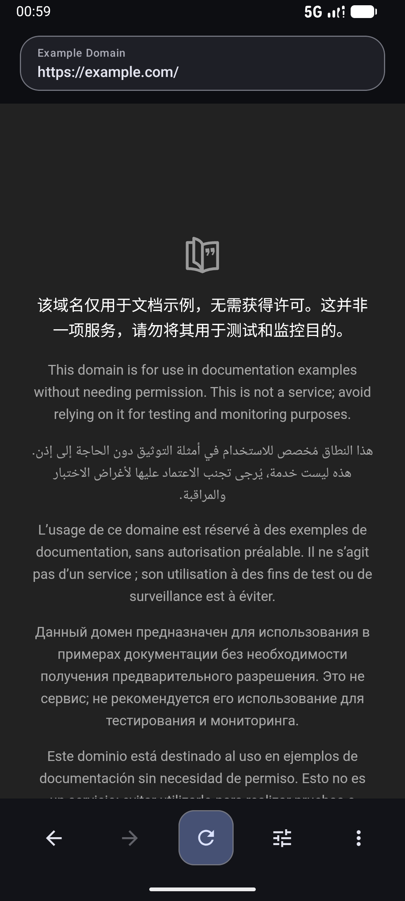
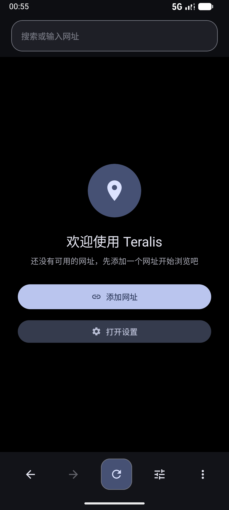
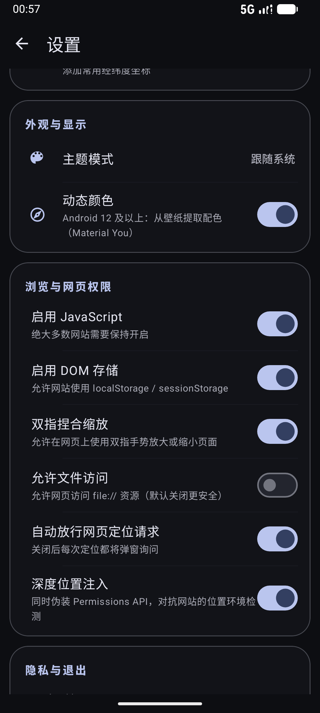

<div align="center">

# Teralis

**一款支持虚拟定位与 User-Agent 伪装的 Android 增强浏览器**
基于 WebView · Material You · 轻量纯粹

[](https://developer.android.com)
[-blue)](https://developer.android.com)
[](https://kotlinlang.org)
[](https://m3.material.io)

</div>

---

## 应用预览

| 浏览网页 | 欢迎引导 | 设置中心 |
| :---: | :---: | :---: |
|  |  |  |

## 核心功能

### 🎭 网页身份伪装
- **虚拟定位**：为任意网址注入自定义经纬度，重写 `Geolocation API`；可选「深度位置注入」，同步伪装 `Permissions API`，对抗网站的位置环境检测；也支持使用设备真实定位
- **User-Agent 伪装**：按网址独立配置 UA，内置系统默认选项，自由增删自定义 UA，切换即时生效
- **多配置档案**：网址 / UA / 虚拟位置三组条目按档案隔离管理，一套配置一个场景，档案间一键切换

### ⚡ 快捷切换
底栏一键呼出切换面板，当前生效的网址、UA、虚拟位置一目了然，无需进入设置即可完成切换，选择后立即重载生效。

### 🌐 完整浏览体验
- 网页下载（系统 DownloadManager 托管）、文件上传、网页全屏视频
- 网页摄像头 / 麦克风权限按需授权
- 页面内查找、双指捏合缩放、分享 / 复制网址、跳转系统浏览器
- 地址栏搜索与网址直达，支持百度 / 必应 / 搜狗搜索引擎切换，加载进度实时反馈，离线错误页友好提示
- 可设为系统默认浏览器，直接承接其他应用跳转过来的网页链接
- 一键清除浏览数据（Cookie / 缓存 / 历史）

### 🎨 Material You 设计
- **动态取色**：Android 12+ 从壁纸提取配色，全局主题随壁纸变化
- **主题图标**：自适应图标含 monochrome 单色图层，Android 13+ 桌面开启「主题图标」后跟随壁纸染色
- **动态启动页**：SplashScreen 背景读取壁纸取色（`system_accent1`），深浅色自动适配
- **全面屏沉浸**：Edge-to-Edge 布局，手势 / 三键导航栏均无色差，深色模式跟随系统

## 技术栈

| 领域 | 方案 |
| --- | --- |
| 语言 | Kotlin（JVM Target 17） |
| UI | ViewBinding · Material Components 1.12 · RecyclerView |
| 网页内核 | Android WebView（自定义 `WebViewClient` / `WebChromeClient`） |
| 启动页 | `androidx.core:core-splashscreen` |
| 数据持久化 | Gson + SharedPreferences（配置档案内存缓存） |
| 构建 | Gradle Kotlin DSL · AGP 9 |
| 兼容范围 | minSdk **26** / targetSdk **37** · 中文 & 英文 |

## 构建

环境要求：Android Studio（最新稳定版）+ JDK 17。

```bash
git clone https://github.com/MXSZTY/Teralis.git
cd Teralis
./gradlew :app:assembleDebug
```

产物位于 `app/build/outputs/apk/debug/app-debug.apk`。也可以直接用 Android Studio 打开项目根目录，同步完成后运行或构建 APK。

## 目录结构

```
app/src/main/java/com/mxszty/teralis/
├── TeralisApp.kt            # Application：主题 / 动态取色初始化
├── data/                    # 配置模型与持久化（ConfigStore、Models）
├── ui/                      # MainActivity、设置中心、快捷切换面板、档案与条目管理
├── web/                     # WebView 配置、定位注入、下载、文件选择、Client 实现
└── util/                    # 网址规范化、外部浏览器跳转等工具
```

## 作者

**MXSZTY（Zhou Tianyang）** · GitHub：[@MXSZTY](https://github.com/MXSZTY)
